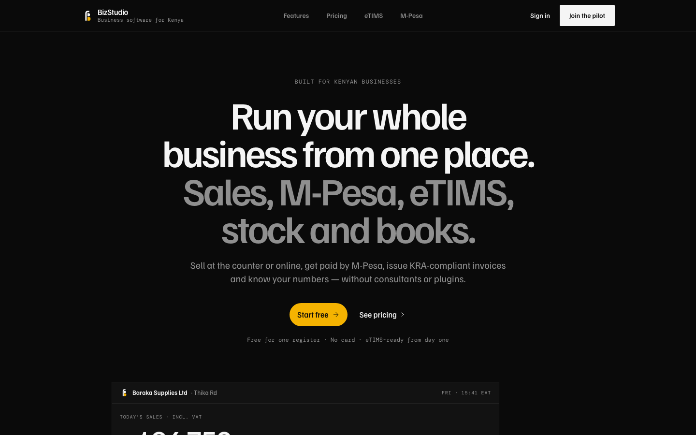
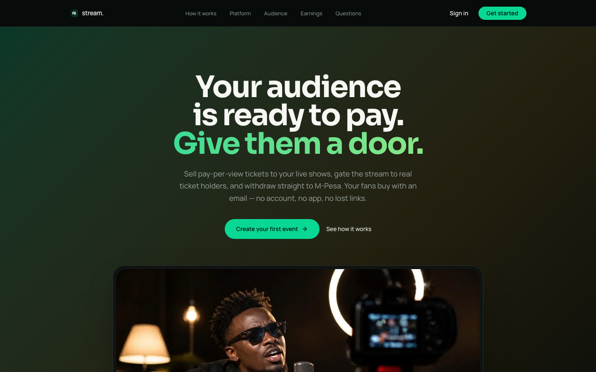
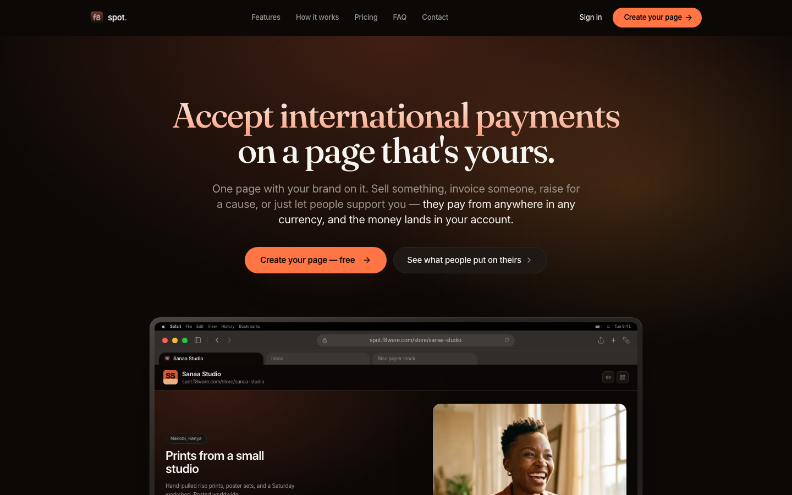
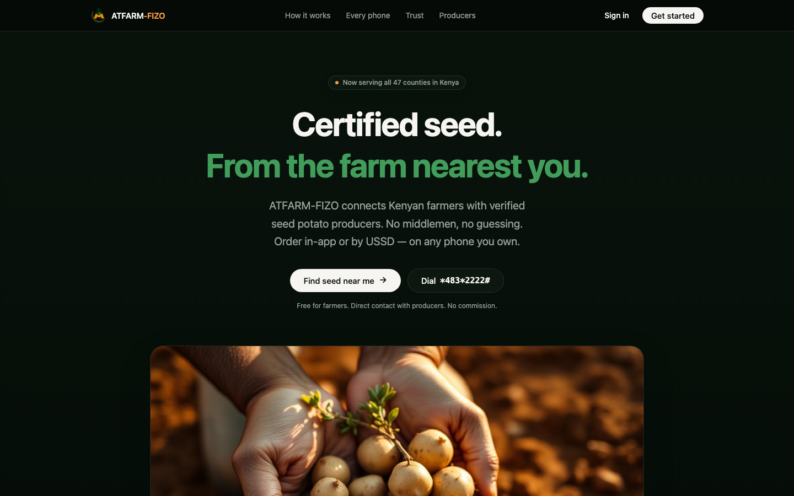

<h1 align="center">Fondo Adam</h1>

<b>Full-stack web & mobile engineer in Kenya. I build products people pay for: fintech, payments, SaaS and marketplaces.</b>

## What I do

- **Web apps & SaaS:** dashboards, multi-tenant platforms and marketing sites that convert (Next.js, React, TypeScript)
- **Mobile apps:** iOS and Android and web from one codebase (React Native, Expo)
- **Payments & fintech:** M-Pesa, Paystack, escrow flows, double-entry ledgers, KRA eTIMS invoicing
- **Africa-ready products:** USSD/SMS access, offline-first, local currencies and payment rails
- **AI features:** assistants and automation built into real products

## Featured work

All live. Click any screenshot to try it.

<table>
<tr>
<td width="50%" valign="top">

**[f8 escrow](https://f8cutoutpro.vercel.app)**: Peer-to-peer crypto trading where every trade is locked in escrow. 
Next.js · React · Convex · Better Auth · <a href="https://github.com/fondoadam/f8-escrow">details</a>
</td>
<td width="50%" valign="top">

**[BizStudio](https://bizstudio-f8.vercel.app)**: Sales, POS, M-Pesa, KRA eTIMS, stock and books for Kenyan businesses, in one place. 
Next.js 16 · React · Convex · Better Auth · <a href="https://github.com/fondoadam/bizstudio">details</a>
</td>
</tr>
<tr>
<td width="50%" valign="top">

**[stream.](https://streamvibe-f8.vercel.app)**: Sell tickets to your live stream. Get paid on M-Pesa. 
Next.js · React · Convex · Clerk · <a href="https://github.com/fondoadam/stream-ticketing">details</a>
</td>
<td width="50%" valign="top">

**[Akiba](https://akiba-sacco.vercel.app)**: Every shilling, visible. A SACCO operating system for Kenyan SACCOs and chamas. 
Expo · React Native · Convex · Better Auth · <a href="https://github.com/fondoadam/akiba-sacco">details</a>
</td>
</tr>
<tr>
<td width="50%" valign="top">

**[f8 spot](https://f8pay.vercel.app)**: Accept international payments on a page that's yours. 
Next.js · React · Convex · Better Auth · <a href="https://github.com/fondoadam/f8spot">details</a>
</td>
<td width="50%" valign="top">

**[ATFARM-FIZO](https://atfarmfizo.vercel.app)**: Certified seed, from the farm nearest you. 
Expo · React Native · Convex · Better Auth · <a href="https://github.com/fondoadam/atfarm-fizo">details</a>
</td>
</tr>
</table>

**More live projects**

- **[f8 Capital](https://kairos-funded.vercel.app)**: Simulated prop-trading evaluations with an in-app terminal and itemized reward math.
- **[PadSafe Africa](https://f8periodpowerprogress.vercel.app)**: A dignified, scalable answer to period poverty.
- **[f8 favicons](https://f8icons.vercel.app)**: Icon and favicon generator for the f8 product family.
- **[Neno Sacco Courier](https://neno-sacco-courier.vercel.app)**: Courier and parcel management system for a transport SACCO.

## Stack

## Work with me

I take on freelance and contract work: new products from idea to launch, MVPs, and rescuing or extending existing apps.
Most of my client and commercial code is private; I'm happy to walk you through it on a call.

**📫 [fondoadam@f8ware.com](mailto:fondoadam@f8ware.com)** · **🌐 [Portfolio](https://fondoadam.f8ware.com)**
